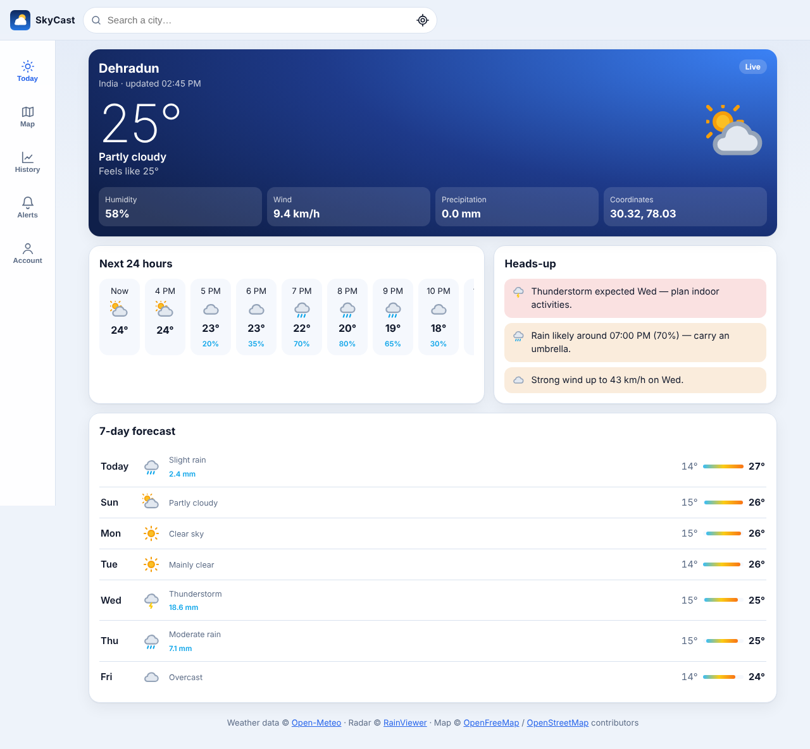
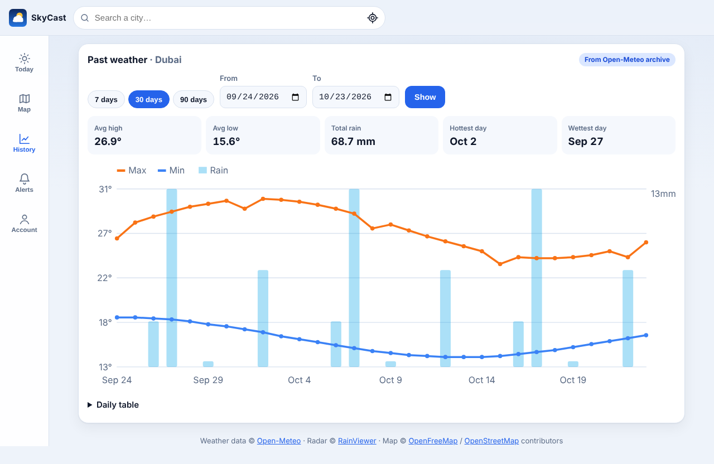
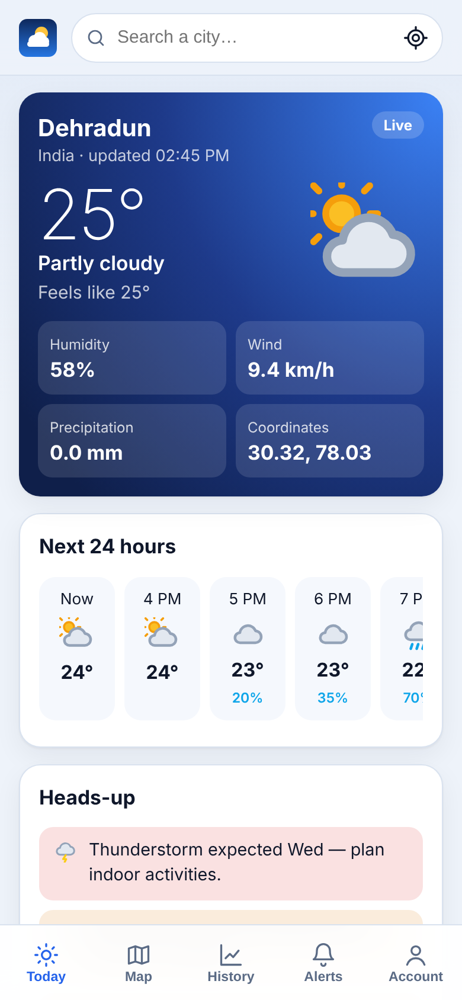
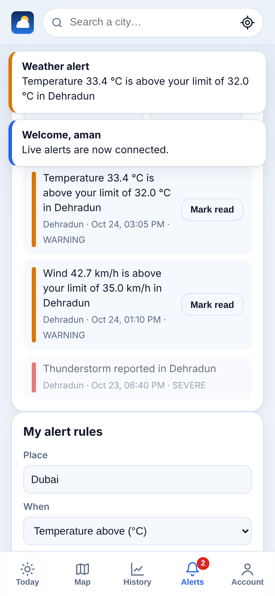
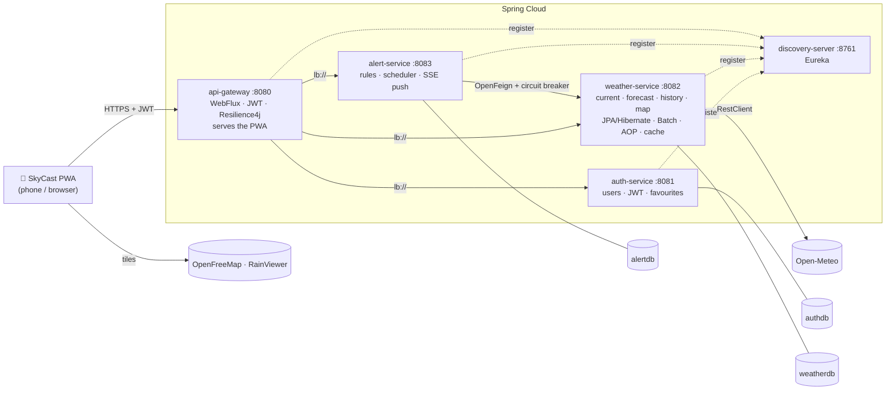

<div align="center">


# SkyCast — Weather Dashboard

**Real-time weather, forecasts, live alerts, history and an interactive weather map. Built as Spring Boot microservices and delivered as an installable mobile web app (PWA).**


[Features](#-features) · [Screenshots](#-screenshots) · [Architecture](#-architecture) · [Quick start](#-quick-start) · [API](#-rest-api) · [Testing](#-testing) · [Deployment](#-deployment) · [Docs](#-documentation)

</div>

---

## 📖 About

SkyCast keeps you up to date with the weather wherever you are. It shows current conditions and a
7-day forecast for any city. It sends you an alert when the weather crosses limits you choose:
heat, cold, strong wind, heavy rain or thunderstorms. You can also look back at past weather with
charts and statistics, or explore an interactive map with an animated rain radar.

The project was built for the **Server Side Engineering** course (B.Tech CSE, DIT University). It
covers the whole syllabus — Maven, Spring Framework, Spring Boot / Spring Cloud and Spring ORM /
Hibernate — in one working application. See [docs/SYLLABUS-MAPPING.md](docs/SYLLABUS-MAPPING.md)
for the topic-by-topic mapping to the code.

All external data sources are **free and need no API key or account**:
[Open-Meteo](https://open-meteo.com/) (weather, forecast, archive, geocoding),
[RainViewer](https://www.rainviewer.com/) (radar) and [OpenFreeMap](https://openfreemap.org/)
(base map, © OpenStreetMap contributors).

## ✨ Features

| | Feature | Details |
|---|---|---|
| 🌤️ | **Real-time weather** | Current temperature, feels-like temperature, humidity, wind and precipitation for any city, or for your own location |
| 📅 | **Forecast** | Next 48 hours plus 7 days. A "Heads-up" card flags sudden changes (storms, heavy rain, big temperature swings) |
| 🔔 | **Real-time alerts** | Your own rules, e.g. "wind above 35 km/h". Thunderstorm and gale warnings are automatic. Alerts are **pushed instantly over Server-Sent Events** and appear as an in-app toast, an unread badge and a system notification |
| 📈 | **Historical data** | Any date range of up to a year, with a chart (max/min temperature and rain bars), stats (averages, total rain, hottest and wettest day) and a daily table |
| 🗺️ | **Interactive map** | Vector base map, animated rain radar (play / scrub) and temperature and wind-direction layers that update as you pan |
| 📱 | **Mobile app (PWA)** | Installable on Android and iPhone, works offline with the last saved data, mobile-first layout, light/dark theme toggle (follows the system setting until you choose) |
| 🛡️ | **Resilient** | If the weather provider is down, circuit breakers serve the last stored reading, so the app never shows a blank screen |
| 🔐 | **Accounts** | Register and sign in with JWT, save favourite places; admin-only tools for statistics and batch import |

## 📸 Screenshots

> Captured by the automated Playwright test against sample data.

| Desktop — today | Desktop — history |
|---|---|
|  |  |

| Mobile — today | Mobile — live alerts |
|---|---|
|  |  |

## 🏗️ Architecture



| Module | Port | Responsibility |
|---|---|---|
| `weather-common` | – | Shared DTOs (Java records), a single JSON error format and a **custom Spring Boot auto-configuration** that makes every servlet service a JWT resource server |
| `discovery-server` | 8761 | Eureka service registry |
| `api-gateway` | 8080 | Spring Cloud Gateway on WebFlux: routing, an edge JWT check, circuit breakers with fallbacks, functional `RouterFunction` endpoints. **Hosts the PWA** |
| `auth-service` | 8081 | Register and login (BCrypt + Spring Security), issues JWTs (jjwt), stores favourite places, admin endpoints with method security |
| `weather-service` | 8082 | Open-Meteo client behind Resilience4j. Snapshots and daily history in JPA/Hibernate with Flyway. Spring Batch history import, AOP metrics aspect, Caffeine and Hibernate L2 caches, JDBC statistics, Thymeleaf status page |
| `alert-service` | 8083 | Alert rules, a scheduled evaluator calling weather-service through OpenFeign, live push with Reactor `Flux` / `Sinks` over SSE |

### Tech stack

| Layer | Technology |
|---|---|
| Language / build | Java 17+ (records, switch expressions, text blocks) · Maven multi-module · Maven Wrapper |
| Backend | Spring Boot 3.5.15 · Spring Cloud 2025.0.3 (Eureka, Gateway, OpenFeign, LoadBalancer, CircuitBreaker) · Resilience4j |
| Security | Spring Security 6 · OAuth2 Resource Server (Nimbus, HS256) · jjwt 0.13.0 · method security |
| Data | Spring Data JPA · Hibernate 6 · Spring JDBC · Flyway · H2 (dev) · PostgreSQL 16 (docker) · Ehcache (L2) · Caffeine |
| Processing | Spring Batch · `@Scheduled` · Spring AOP · Project Reactor (Mono / Flux / Sinks) |
| Observability | Spring Boot Actuator · Micrometer + Prometheus · OpenTelemetry tracing bridge |
| API docs | springdoc-openapi 2.8.17 (Swagger UI) |
| Frontend | Vanilla JS modules · Leaflet 1.9.4 · MapLibre GL 6.13.0 · Service Worker · Web App Manifest (everything bundled, no CDN) |
| DevOps | Docker (multi-stage) · Docker Compose · Kubernetes manifests · Helm · GitHub Actions · Jenkins |

## 🚀 Quick start

### Prerequisites

- **JDK 17 or newer** (Temurin 21 recommended). Check with `java -version`.
- *Optional:* Docker Desktop (for PostgreSQL / full stack), Node 18+ (for the frontend e2e tests).
- **Maven is not required.** The included Maven Wrapper (`mvnw`, `mvnw.cmd`) downloads Maven 3.9.11 automatically.

### 1. Clone

```bash
git clone https://github.com/<your-username>/skycast-weather-dashboard.git
cd skycast-weather-dashboard
```

### 2. Build and test

```bash
# Windows
mvnw.cmd verify
# macOS / Linux
./mvnw verify
```

The first build downloads roughly 300 MB of dependencies. It should end with `BUILD SUCCESS` and 62 passing tests.

### 3. Run all services (no Docker needed, uses in-memory H2)

```powershell
# Windows (PowerShell) — opens one window per service, in the right order
powershell -ExecutionPolicy Bypass -File scripts\run-local.ps1
```

```bash
# macOS / Linux — logs go to ./logs
sh scripts/run-local.sh
```

<details>
<summary>Or start each service by hand (5 terminals, in this order)</summary>

```bash
./mvnw -q install -DskipTests                  # once, installs weather-common locally
./mvnw -pl discovery-server spring-boot:run    # wait until http://localhost:8761 is up
./mvnw -pl auth-service spring-boot:run
./mvnw -pl weather-service spring-boot:run
./mvnw -pl alert-service spring-boot:run
./mvnw -pl api-gateway spring-boot:run
```
In **IntelliJ IDEA** or **Eclipse**, import the folder as a Maven project and run the `*Application`
classes in the same order.
</details>

### 4. Open the app

Go to **http://localhost:8080**. Give Eureka about 30 seconds after start-up to register all services.

| Demo account | Password | Role |
|---|---|---|
| `demo` | `demo123` | USER |
| `admin` | `admin123` | ADMIN + USER |

Then try it out:

1. Search a city.
2. Open the **Map** tab and press ▶ **Play** on the radar.
3. Pick a range on **History**.
4. Sign in.
5. On **Alerts**, click **Enable notifications**, then **Send test alert**.

### Run with Docker (PostgreSQL)

```bash
cp .env.example .env                 # then set your own secrets
docker compose up --build            # app on http://localhost:8080
docker compose --profile observability up --build   # + Prometheus :9090, Grafana :3000
```

### Install on your phone

Browsers only allow service workers, installation and notifications over **HTTPS** or on `localhost`.

1. Expose the gateway through a free tunnel: `cloudflared tunnel --url http://localhost:8080` (or `ngrok http 8080`).
2. Open the `https://…` link on your phone.
3. **Add to Home screen:** *Install app* on Android Chrome, or *Share → Add to Home Screen* on iPhone Safari.

### Useful URLs

| URL | What |
|---|---|
| http://localhost:8080 | SkyCast app |
| http://localhost:8761 | Eureka dashboard |
| http://localhost:8082/swagger-ui.html | Swagger UI (also on :8081 and :8083) |
| http://localhost:8082/status | Server-rendered status page (Spring MVC + Thymeleaf) |
| http://localhost:8082/actuator/health | Health (also `/actuator/prometheus`, `/actuator/metrics`) |
| http://localhost:8080/api/system/services | Services currently registered (reactive endpoint) |

## ⚙️ Configuration

Every secret has a development default and is overridden with environment variables:

| Variable | Used by | Purpose | Default (dev only) |
|---|---|---|---|
| `JWT_SECRET` | all services + gateway | HS256 signing key (≥ 32 chars) | dev placeholder |
| `ADMIN_PASSWORD` / `DEMO_PASSWORD` | auth-service | seeded demo accounts | `admin123` / `demo123` |
| `SPRING_PROFILES_ACTIVE` | all | `dev` (H2) or `docker` (PostgreSQL) | `dev` |
| `DB_HOST`, `DB_NAME`, `DB_USER`, `DB_PASSWORD` | services (docker profile) | PostgreSQL connection | `postgres`, per-service DB, `skycast` |
| `EUREKA_URL` | all | registry address | `http://localhost:8761/eureka` |
| `PORT` | each service | HTTP port | 8080–8083, 8761 |

Maven profiles: `-Pdev` (default), `-Pdocker` (passes the docker profile to `spring-boot:run`), `-Pfast` (skip tests).

> ⚠️ Change `JWT_SECRET` and the passwords before deploying anywhere public. Never commit `.env`.

## 🔌 REST API

All calls go through the gateway on port 8080. Errors always use the shape `{status, error, message, path, timestamp}`.

| Method & path | Auth | Description |
|---|---|---|
| `POST /api/auth/register`, `POST /api/auth/login` | – | Returns `{token, username, roles, expiresAt}` |
| `GET /api/users/me`, `GET/POST/DELETE /api/users/me/favorites` | JWT | Profile and favourite places |
| `GET /api/users` | ADMIN | All users |
| `GET /api/weather/current?lat=&lon=&name=` | – | Current conditions (`source`: `LIVE` or `CACHED`) |
| `GET /api/weather/forecast?lat=&lon=` | – | 48 h hourly + 7-day daily forecast |
| `GET /api/weather/history?lat=&lon=&start=&end=` | – | Daily history + stats (`DATABASE` / `ARCHIVE` / `PARTIAL`) |
| `GET /api/weather/geocode?q=` | – | Place search |
| `GET /api/weather/map?north=&south=&east=&west=` | – | 5×5 temperature / wind grid for the map view |
| `GET /api/weather/locations?name=&country=`, `/locations/recent` | – | Criteria API search, HQL query |
| `GET /api/weather/stats?hours=24` | ADMIN | JDBC aggregate statistics |
| `POST /api/weather/admin/history-import?days=30` | ADMIN | Runs the Spring Batch import job |
| `GET /api/alerts`, `POST /api/alerts/{id}/ack`, `POST /api/alerts/ack-all` | JWT | My alerts |
| `GET/POST /api/alerts/rules`, `PATCH/DELETE /api/alerts/rules/{id}` | JWT | My alert rules |
| `GET /api/alerts/stream?access_token=` | JWT | **Server-Sent Events** live stream |
| `POST /api/alerts/test` | JWT | Push a test alert |
| `POST /api/alerts/admin/evaluate` | ADMIN | Evaluate all rules now |

<details>
<summary>Example: sign in and read the forecast with curl</summary>

```bash
TOKEN=$(curl -s -H 'Content-Type: application/json' \
  -d '{"username":"demo","password":"demo123"}' http://localhost:8080/api/auth/login | jq -r .token)

curl -s "http://localhost:8080/api/weather/forecast?lat=30.32&lon=78.03" | jq '.daily[0]'
curl -s -H "Authorization: Bearer $TOKEN" http://localhost:8080/api/alerts/rules
curl -N "http://localhost:8080/api/alerts/stream?access_token=$TOKEN"     # live alert stream
```
</details>

## 🧪 Testing

```bash
./mvnw verify                 # all backend tests (Windows: mvnw.cmd verify or scripts\verify-build.cmd)
```

| Test class | Kind | What it proves |
|---|---|---|
| `ContractFixturesTest` | Contract | The JSON fixtures used by the frontend tests round-trip exactly through the backend DTOs |
| `OpenMeteoClientTest` | `RestClient` + `MockRestServiceServer` | Correct provider URLs and parsing, without network |
| `WeatherServiceTest`, `HistoryAndMapLogicTest`, `AlertEvaluatorTest` | Unit (Mockito) | Live path, cached fallback and 503 handling; stats; alert rules and cooldown |
| `WeatherRepositoryTest` | `@DataJpaTest` (H2 + real Flyway) | Derived, JPQL, native, named, Criteria and HQL queries; locking; auditing; XML mapping; JDBC |
| `WeatherApiTest`, `AuthFlowTest`, `AlertApiTest` | `@SpringBootTest` + MockMvc | Security (401/403), validation, fallbacks, Batch job, Thymeleaf view |
| `AlertStreamServiceTest` | Reactor `StepVerifier` | Per-user live alert stream |
| `GatewayTest` | `WebTestClient` | JWT at the edge, circuit-breaker fallback, router functions, PWA served |

**Frontend end-to-end** (Playwright, phone and desktop sizes, mock API built from the same contract fixtures):

```bash
cd verify && npm install && npx playwright install chromium && cd ..
node verify/e2e.mjs                  # 76 checks, screenshots in verify/out/
python verify/check-mapping.py       # verifies all 103 syllabus topics exist in the code
```

**Smoke test** against a running stack: `scripts/smoke-test.ps1` (Windows) or `sh scripts/smoke-test.sh`.

## 📦 Deployment

| Target | How |
|---|---|
| Docker | One multi-stage `Dockerfile` for every module: `docker build --build-arg MODULE=weather-service .` |
| Docker Compose | `docker compose up --build`: PostgreSQL with one database per service, plus health-checked start order |
| Kubernetes | `kubectl apply -f k8s/` (Namespace, ConfigMap, Secret, PostgreSQL StatefulSet, Deployments with liveness and readiness probes) |
| Helm | `helm install skycast ./helm/skycast -n skycast --create-namespace --set secrets.jwtSecret=…` |
| CI — GitHub Actions | `.github/workflows/ci.yml`: Maven verify on Java 17 and 21 → Playwright e2e → Docker images on `main` |
| CI/CD — Jenkins | `Jenkinsfile`: build & test → images → push → `helm upgrade --install` |
| Cloud | AWS (ECR + EKS/ECS + RDS), Azure (ACR + Container Apps/AKS + PostgreSQL Flexible Server), serverless containers — see [docs/DEPLOYMENT.md](docs/DEPLOYMENT.md) |

> `weather-service` and `alert-service` run scheduled jobs, so keep them at **one replica**. Running more would need a distributed lock such as ShedLock.

## 📁 Project structure

```
.
├── pom.xml                      # parent POM: modules, BOMs, profiles
├── mvnw, mvnw.cmd, .mvn/        # Maven Wrapper
├── weather-common/              # DTOs, error handler, JWT auto-configuration, contract fixtures
├── discovery-server/            # Eureka
├── api-gateway/                 # Gateway + PWA (src/main/resources/static)
├── auth-service/                # users, JWT, favourites
├── weather-service/             # weather, history, map, Batch, AOP, ORM showcase
├── alert-service/               # alert rules, Feign, SSE
├── Dockerfile, docker-compose.yml, docker/
├── k8s/, helm/skycast/          # Kubernetes manifests + Helm chart
├── .github/workflows/, Jenkinsfile
├── scripts/                     # run-local / smoke-test / verify-build (PowerShell + sh)
├── verify/                      # Playwright e2e, mock API, syllabus checker
└── docs/                        # syllabus mapping, viva notes, deployment guide, screenshots
```

## 📚 Documentation

- [docs/SYLLABUS-MAPPING.md](docs/SYLLABUS-MAPPING.md): every syllabus topic (Units 1–4) mapped to the file and code that implements it. The mapping is checked automatically.
- [docs/VIVA-NOTES.md](docs/VIVA-NOTES.md): short explanations per unit and likely exam questions.
- [docs/DEPLOYMENT.md](docs/DEPLOYMENT.md): Kubernetes, AWS, Azure and serverless deployment steps.

## 🛠️ Troubleshooting

| Problem | Fix |
|---|---|
| `java` not found, or "release version 17 not supported" | Install JDK 17+ and reopen the terminal |
| Gateway returns `503 … temporarily unavailable` | The service has not registered in Eureka yet. Wait ~30 s or check http://localhost:8761 |
| Weather card shows **Saved data** | Open-Meteo was unreachable, so the circuit breaker served the last stored reading |
| `Port already in use` | Stop the old process, or set `PORT` for that service |
| UI does not update after a rebuild | Hard-reload with **Ctrl + Shift + R** (bypasses the service worker) |

## 🗺️ Roadmap

- Web Push (VAPID) so alerts arrive even when the app is closed
- Kafka / Spring Cloud Stream for alert fan-out across several replicas, plus ShedLock for schedulers
- Upgrade to Spring Boot 4 / Spring Cloud 2025.1

## 🙏 Acknowledgements

Weather data by [Open-Meteo](https://open-meteo.com/) (CC BY 4.0) · radar by [RainViewer](https://www.rainviewer.com/) ·
base map by [OpenFreeMap](https://openfreemap.org/) and [OpenMapTiles](https://openmaptiles.org/), data © [OpenStreetMap](https://www.openstreetmap.org/copyright) contributors ·
[Leaflet](https://leafletjs.com/) (BSD-2) · [MapLibre GL JS](https://maplibre.org/) (BSD-3).

## 👤 Author

**Aman Deep**: B.Tech CSE (Full Stack Development & DevOps), DIT University, Dehradun.
Built as the Server Side Engineering course project.

---

<div align="center">If you found this useful, consider giving the repo a ⭐</div>
